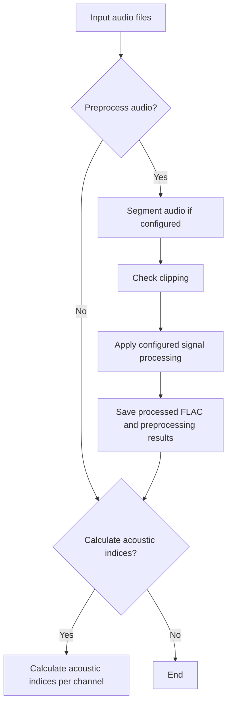

# SuEcO Acoustic Pipeline

A reproducible Python workflow for preprocessing cave soundscape recordings and calculating acoustic indices.

This repository provides the audio-processing component of the **Subterranean Ecoacoustic Observatory (SuEcO)** and its proposed **Cave Ecoacoustic Data Cube (CEDC)** workflow. It accompanies the manuscript *Listening to cave ecosystems for earth system conservation* (Forti et al.).

The pipeline is intended for batch processing at SuEcO research nodes. It standardizes audio preparation, records quality-control issues, and produces analysis-ready Parquet tables. It does not identify species or implement the complete CEDC data model.

> [!IMPORTANT]
> Acoustic indices are soundscape descriptors, not direct measures of biodiversity or ecosystem condition. Interpret them with study-specific ecological validation and, where possible, relative to site-specific acoustic baselines.

## Features

* Supports mono and stereo recordings.
* Supports preprocessing and acoustic-index extraction as independent or combined processing stages.
* Optionally divides long recordings into overlapping or non-overlapping segments.
* Detects clipping independently in each audio channel.
* Removes DC offset by default.
* Optionally downsamples recordings when required.
* Saves processed recordings in lossless FLAC format.
* Calculates temporal and spectral acoustic indices with [scikit-maad](https://scikit-maad.github.io/).
* Supports parallel processing across multiple audio files.
* Stores processing results and errors in Parquet files.

## How the pipeline works

Preprocessing and acoustic-index extraction can run together or independently:



When both stages are enabled, acoustic indices are calculated from successfully preprocessed audio. In index-only mode, input files are analyzed directly without segmentation or preprocessing.

## Quick start

### 1. Get the project

Download or clone the project, then open a terminal in its root directory.

#### Option A — Download from GitHub

Select **Code → Download ZIP** on GitHub, extract the archive, and open the extracted folder.

#### Option B — Clone with Git

```bash
git clone https://github.com/weslleygere/sueco-acoustic-pipeline.git
cd sueco-acoustic-pipeline
```

### 2. Create a virtual environment

This project uses **Python 3.14**. Before continuing, confirm that the command for your operating system reports `Python 3.14.x`.

Windows:

```powershell
python --version
```

macOS or Linux:

```bash
python3.14 --version
```

Windows PowerShell:

```powershell
python -m venv .venv
.\.venv\Scripts\Activate.ps1
```

macOS or Linux:

```bash
python3.14 -m venv .venv
source .venv/bin/activate
```

### 3. Install the dependencies

```bash
python -m pip install --upgrade pip
python -m pip install -r requirements.txt
```

### 4. Create your local environment file

Copy `.env.example` to a new file named `.env`.

Windows PowerShell:

```powershell
Copy-Item .env.example .env
```

macOS or Linux:

```bash
cp .env.example .env
```

### 5. Configure and run the pipeline

Configure `.env` and `config_params.json` as described in the [Configuration](#configuration) section.

Create the directory configured by `INPUT_DIR` (`input/` by default) if it does not exist, and place one or two test recordings inside it.

Then run:

```bash
python main.py
```

## Recommended SuEcO recording protocol

For standardized cave ecoacoustic monitoring, SuEcO recommends:

| Component          | Recommendation                                    |
| ------------------ | ------------------------------------------------- |
| Recording duration | **1 minute**                                      |
| Recording interval | **Every 60 minutes throughout the 24-hour cycle** |
| Sampling rate      | **96 kHz**                                        |
| Audio format       | **Uncompressed WAV**                              |
| Channels           | **Stereo when supported by the recorder**         |

These recommendations provide a common baseline to improve comparability among cave ecoacoustic studies. Alternative sampling designs may be appropriate for specific research questions, but deviations should be documented.

The processing defaults described below are designed to complement this recommended recording protocol.

## Configuration

The pipeline separates **runtime settings** from **processing parameters**:

| File                                       | Purpose                                                         |
| ------------------------------------------ | --------------------------------------------------------------- |
| [`.env.example`](.env.example) → `.env`    | Input/output paths, enabled processing stages, and worker count |
| [`config_params.json`](config_params.json) | Preprocessing and acoustic-index parameters                     |

### Runtime settings: `.env`

The `.env` file controls where the audio files are located, where results are saved, and which stages of the pipeline are enabled.

```dotenv
CONFIG_PARAMS_PATH=config_params.json

INPUT_DIR=input
AUDIO_EXTENSIONS=.wav,.flac,.aif,.aiff,.ogg

OUTPUT_DIR=output

PREPROCESS_AUDIO=true
EXTRACT_ACOUSTIC_INDICES=false

MAX_WORKERS=-1
```

| Setting                    |                      Default | Description                                                                                                      |
| -------------------------- | ---------------------------: | ---------------------------------------------------------------------------------------------------------------- |
| `CONFIG_PARAMS_PATH`       |         `config_params.json` | Path to the JSON file containing the processing parameters                                                       |
| `INPUT_DIR`                |                      `input` | Directory containing the audio files to process                                                                  |
| `AUDIO_EXTENSIONS`         | `.wav,.flac,.aif,.aiff,.ogg` | Comma-separated audio extensions included in the search                                                          |
| `OUTPUT_DIR`               |                     `output` | Directory where results are saved                                                                                |
| `PREPROCESS_AUDIO`         |                       `true` | Enable audio preprocessing                                                                                       |
| `EXTRACT_ACOUSTIC_INDICES` |                      `false` | Enable acoustic-index calculation                                                                                |
| `MAX_WORKERS`              |                         `-1` | Number of workers used to process files; use an integer `≥ 1`, or `-1` to use all available CPU cores except one |

`INPUT_DIR` can point to any directory containing the recordings to be processed. Its subdirectories are searched recursively.

At least one processing stage must be enabled:

| `PREPROCESS_AUDIO` | `EXTRACT_ACOUSTIC_INDICES` | Behavior                                                               |
| -----------------: | -------------------------: | ---------------------------------------------------------------------- |
|             `true` |                    `false` | Preprocess and save audio                                              |
|             `true` |                     `true` | Preprocess audio, then calculate indices from the processed recordings |
|            `false` |                     `true` | Calculate indices directly from the input audio                        |
|            `false` |                    `false` | Invalid configuration                                                  |

### Processing parameters: `config_params.json`

The default `config_params.json` contains the processing settings recommended by the SuEcO workflow.

```json
{
  "preprocessing": {
    "segmentation": {
      "duration_seconds": null,
      "overlap_seconds": 0
    },
    "quality_control": {
      "clipping_amplitude_threshold": 0.99
    },
    "signal_processing": {
      "remove_dc_offset": true,
      "target_sample_rate_hz": null
    }
  },
  "acoustic_indices": {
    "compatibility_mode": "seewave",
    "frequency_bands_hz": {
      "low": [0, 1000],
      "mid": [1000, 10000],
      "high": [10000, 48000]
    }
  }
}
```

#### Preprocessing parameters

| Parameter                                      | Default | Meaning                                                                            |
| ---------------------------------------------- | ------: | ---------------------------------------------------------------------------------- |
| `segmentation.duration_seconds`                |  `null` | Segment duration in seconds; `null` keeps each recording as a single unit          |
| `segmentation.overlap_seconds`                 |     `0` | Overlap in seconds between consecutive segments                                    |
| `quality_control.clipping_amplitude_threshold` |  `0.99` | Normalized peak amplitude at which a channel is considered clipped                 |
| `signal_processing.remove_dc_offset`           |  `true` | Removes the constant DC component; recommended for standard SuEcO processing       |
| `signal_processing.target_sample_rate_hz`      |  `null` | Target sampling rate for downsampling; `null` preserves the original sampling rate |

Because the recommended SuEcO sampling unit is already **1 minute**, segmentation is disabled by default. For longer recordings, set:

```json
"duration_seconds": 60
```

to divide them into 1-minute segments.

Clipping is evaluated independently for each channel:

| Input condition               | Result                         |
| ----------------------------- | ------------------------------ |
| Mono, valid                   | Retained as mono               |
| Mono, clipped                 | Segment rejected               |
| Stereo, both channels valid   | Retained as stereo             |
| Stereo, one channel clipped   | Valid channel retained as mono |
| Stereo, both channels clipped | Segment rejected               |

When one stereo channel is clipped, the clipping issue is recorded while the valid channel continues through the pipeline.

DC-offset removal is recommended for standard SuEcO processing. It may be disabled when a study specifically aims to compare results with and without DC removal.

For recordings collected at the recommended **96 kHz** sampling rate, keep:

```json
"target_sample_rate_hz": null
```

Downsampling is intended for recordings acquired above 96 kHz. To downsample a higher-rate recording to the recommended sampling rate, use:

```json
"target_sample_rate_hz": 96000
```

The pipeline does not use this parameter to upsample recordings.

#### Acoustic-index parameters

| Parameter                 |          Default | Meaning                                        |
| ------------------------- | ---------------: | ---------------------------------------------- |
| `compatibility_mode`      |        `seewave` | Compatibility convention used by `scikit-maad` |
| `frequency_bands_hz.low`  |      `[0, 1000]` | Low-frequency band in hertz                    |
| `frequency_bands_hz.mid`  |  `[1000, 10000]` | Mid-frequency band in hertz                    |
| `frequency_bands_hz.high` | `[10000, 48000]` | High-frequency band in hertz                   |

The default frequency bands are designed for the recommended **96 kHz** recordings, which have a Nyquist frequency of **48 kHz**. If recordings have a lower sampling rate, the upper frequency limits must be adjusted before calculating acoustic indices.

These parameters provide a standardized baseline for cave ecoacoustic studies. Researchers may modify them when required by their study design or research question, but deviations from the recommended SuEcO settings should be documented.

## Input recordings

`INPUT_DIR` is searched recursively, so recordings may remain organized according to the structure of the study, for example by cave, recorder, or deployment:

```text
<INPUT_DIR>/
├── cave_A/
│   ├── recording_001.wav
│   └── recording_002.wav
└── cave_B/
    └── recording_001.wav
```

The software supports the audio extensions listed in `AUDIO_EXTENSIONS`, although **uncompressed WAV** is the recommended format for standardized SuEcO recordings.

## Outputs

Every run creates a timestamped directory below `OUTPUT_DIR`:

```text
output/
└── YYYYMMDD_HHMMSS/
    ├── experiment.log
    ├── processed_audio/
    ├── preprocessing_success.parquet
    ├── preprocessing_issues.parquet
    ├── acoustic_indices.parquet
    └── acoustic_index_failures.parquet
```

`experiment.log` is created for every run. Processed audio and Parquet reports are created only when they contain results.

| Output                            | Contents                                                    |
| --------------------------------- | ----------------------------------------------------------- |
| `processed_audio/`                | Successfully preprocessed recordings saved as lossless FLAC |
| `preprocessing_success.parquet`   | Processing provenance for successfully processed recordings |
| `preprocessing_issues.parquet`    | Clipping and other preprocessing issues                     |
| `acoustic_indices.parquet`        | Calculated temporal and spectral acoustic indices           |
| `acoustic_index_failures.parquet` | Errors encountered during acoustic-index calculation        |
| `experiment.log`                  | Configuration and execution information for the run         |

Processed filenames preserve channel provenance. For example, `_wav_mono_right.flac` indicates that the original recording was stereo and only the right channel was retained. Segmented recordings also include a zero-padded marker such as `_chunk_000000`.

## Citation

If you use this pipeline, please cite the associated manuscript once its final publication details are available:

> Forti, L. R. et al. *Listening to cave ecosystems for earth system conservation*. DOI.

Acoustic-index calculations are provided by `scikit-maad`. Please also cite:

> Ulloa, J. S., Haupert, S., Latorre, J. F., Aubin, T., & Sueur, J. (2021). scikit-maad: An open-source and modular toolbox for quantitative soundscape analysis in Python. *Methods in Ecology and Evolution*. https://doi.org/10.1111/2041-210X.13711


## Support and contributions

Use GitHub Issues to report bugs, ask usage questions, or propose improvements.

When reporting a processing problem, include the Python version, relevant non-sensitive configuration, input audio properties, and the corresponding log message.

Pull requests are welcome. Changes affecting the recommended SuEcO defaults or processing behavior should be clearly documented.

## License

This project is licensed under the [BSD 3-Clause License](LICENSE).
